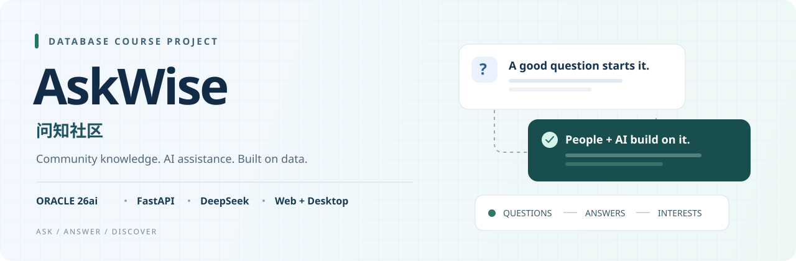
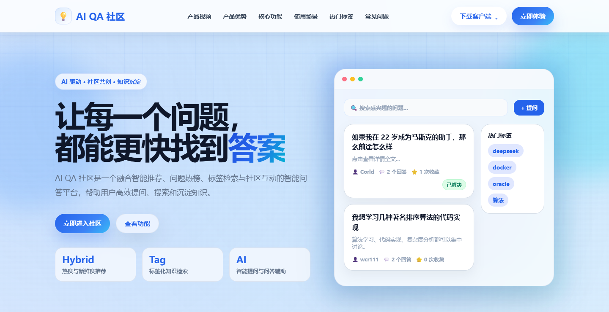
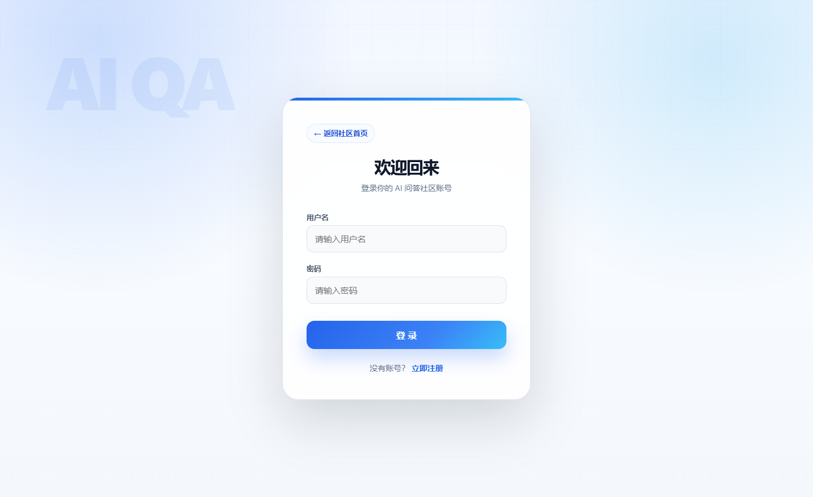
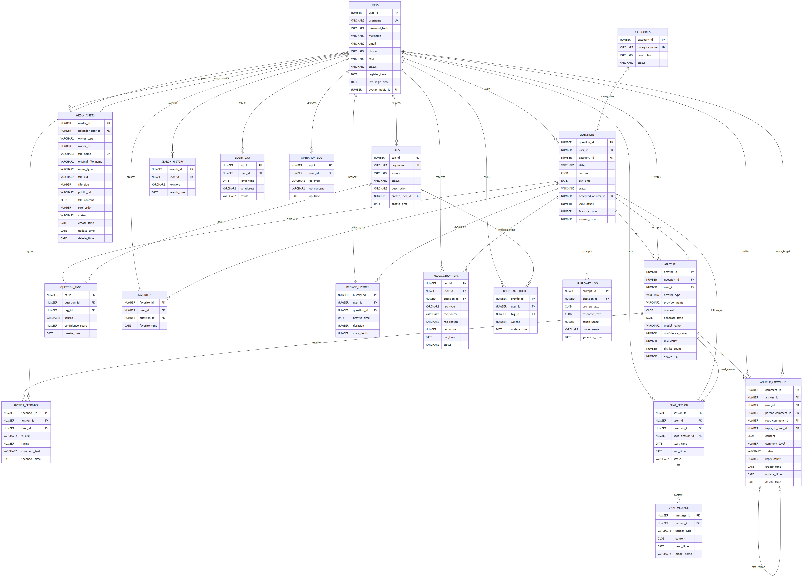
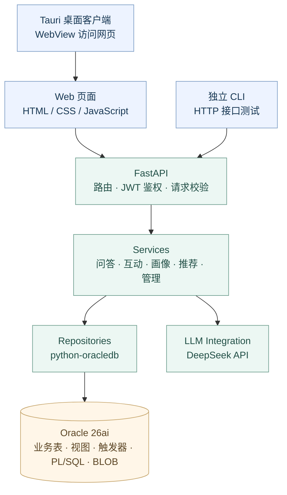

<p align="center">
  
</p>

<h1 align="center">问知社区 AskWise</h1>

<p align="center">
  <strong>从一个问题，到一份答案，再到有价值的社区交流。</strong><br>
  An AI-assisted Q&amp;A community built as a database course project.
</p>

<p align="center">
  <a href="LICENSE"></a>
  
  
  
  
</p>

<p align="center">
  <a href="#preview">界面预览</a> ·
  <a href="#features">功能概览</a> ·
  <a href="#database-design">数据库设计</a> ·
  <a href="#quick-start">快速开始</a> ·
  <a href="docs/course_project_guide.md">课程展示指南</a> ·
  <a href="https://github.com/yiguoyi1/ai-qa-db-course-project/releases/latest">发行包</a>
</p>

## 关于项目

**源码下载：** [GitHub Releases](https://github.com/yiguoyi1/ai-qa-db-course-project/releases/latest)。请选择 Assets 中的 `askwise-community-*-source.zip`，解压后按包内 README 配置环境；这是源码发行包，不是桌面安装器。[发行包使用说明](docs/releases/source_readme.md)

**AskWise 是一个面向通用话题的问答社区，也是一次从 Oracle 数据建模到全栈应用实现的课程实践。** 用户可以发布问题、互相回答、采纳答案和参与楼中楼讨论；AI 提供首答与多轮追问辅助，用户行为则用于构建兴趣画像和推荐问题。

项目包含 **Web 网页、Tauri 桌面客户端、独立 CLI** 三种入口，共用 FastAPI 后端。数据库设计覆盖业务数据、完整性约束、索引、视图、触发器、存储过程与大对象存储。

| 项目方向 | 主要实现 |
| --- | --- |
| 数据库课程设计 | Oracle 26ai、19 张业务表、9 个视图、5 个触发器、PL/SQL 过程与函数 |
| 全栈社区应用 | 注册登录、问题与回答、评论、采纳、收藏、媒体上传和管理员治理 |
| AI 与个性化 | DeepSeek 首答与追问、自动分类与标签、行为画像和可解释的混合推荐 |

<a id="preview"></a>

## 界面预览

[](docs/assets/product-home.png)

<details>
<summary>查看登录与注册入口</summary>

<br>

[](docs/assets/product-login.png)

</details>

截图来自仓库中的实际前端页面；产品介绍页内的社区卡片为原有静态示意。可下载 [产品介绍视频](promo/ai-qa-community-enterprise-saas-promo.mp4)，或在本地启动后体验完整社区。

<a id="features"></a>

## 功能概览

| 模块 | 已实现能力 |
| --- | --- |
| 社区问答 | 发布问题、人工回答、答案采纳、作者与管理员删除、回答数量同步 |
| 交流互动 | 评论与楼中楼、回复自己的评论、软删除占位、收藏、点赞与点踩 |
| AI 辅助 | 可选 AI 首答、基于首答的多轮追问、自动分类、自动匹配或生成标签 |
| 内容发现 | 关键词搜索、分类与标签筛选、热榜、浏览与搜索历史 |
| 用户与画像 | JWT 登录、个人资料、头像、行为标签画像、混合推荐与推荐理由 |
| 媒体与治理 | 问题和回答配图、Oracle BLOB 存储、用户与内容管理、登录与操作审计 |

**几个具体的业务约束：**

- AI 追问绑定原问题与 AI 首答，其他已登录用户可以查看会话，只有创建者能续写。
- 评论删除后保留关联回复，展示删除占位；回答软删除后不计入有效回答数。
- 采纳答案必须属于当前问题，权限校验与数据库约束共同保障归属关系。
- 推荐综合标签兴趣、相似兴趣、热度、新鲜度、已浏览和负反馈等信号，保留可解释的推荐原因。

<a id="database-design"></a>

## 数据库设计

Oracle 是业务实现的一部分。统计同步、推荐评分和兴趣画像都有对应的数据库对象，可以从界面操作一路追踪到 SQL。

| 数据库能力 | 业务用途 | 实现入口 |
| --- | --- | --- |
| 表、主外键与检查约束 | 19 张表组织用户、内容、互动、会话和行为数据 | [create_tables.sql](sql/create_tables.sql) |
| IDENTITY 与索引 | 自动分配主键，为关联查询、筛选和排序提供索引 | [create_tables.sql](sql/create_tables.sql) |
| 9 个视图 | 问题概览、热榜、回答质量、画像、推荐、标签、用户行为、媒体与追问汇总 | [views.sql](sql/views.sql) |
| 5 个触发器 | 回答、收藏、浏览、反馈变化后同步统计；更新最近登录时间 | [triggers.sql](sql/triggers.sql) |
| PL/SQL 包 | `qa_app_pkg` 提供 4 个过程和 1 个函数，完成统计同步、画像重建与推荐生成 | [procedures.sql](sql/procedures.sql) |
| CLOB / BLOB | 存储问题正文、回答、消息、AI 日志与图片二进制 | [create_tables.sql](sql/create_tables.sql) |
| 迁移与校验 | 增量升级、种子数据、对象编译检查和业务规则验证 | [migrations](sql/migrations)、[校验脚本](scripts/validate-oracle-schema.ps1) |

<details>
<summary>展开实体关系图（ER 图）</summary>

<br>

[](docs/diagrams/ai_qa_er_diagram.svg)

完整图可查看 [SVG](docs/diagrams/ai_qa_er_diagram.svg)、[Mermaid 源文件](docs/diagrams/ai_qa_er_diagram.mmd) 与 [关系说明](docs/design_details/er_diagram.md)。

</details>

课程展示时，可结合 [数据库对象与业务对应说明](docs/course_project_guide.md) 讲解设计选择，并演示删除回答后的统计一致性。

## 系统架构



桌面端复用 Web 页面和后端 API。AI 接入封装在独立模块中，数据库访问集中在 repository 层。更多说明见 [业务代码架构](docs/design_details/business_code_architecture.md) 与 [功能模块图](docs/design_details/function_module_diagram.md)。

<a id="quick-start"></a>

## 快速开始

以下是 **Windows + PowerShell 的全新本地环境**流程。准备 Python 3.10+、启用 Linux 容器的 Docker Desktop，以及可用的 Oracle Container Registry 镜像访问权限。桌面客户端另需 Node.js、Rust 和系统构建工具，见 [桌面端指南](docs/desktop_client_setup.md)。

### 1. 获取项目与安装依赖

```powershell
git clone https://github.com/yiguoyi1/ai-qa-db-course-project.git
cd ai-qa-db-course-project
python -m venv .venv
.\.venv\Scripts\python.exe -m pip install -r requirements.txt
Copy-Item .env.example .env
```

编辑 `.env`，设置 `ORACLE_PWD`、`APP_USER_PASSWORD` 和独立生成的 `JWT_SECRET_KEY`；使用 AI 功能时填写自己的 `DEEPSEEK_API_KEY`。配置模板见 [.env.example](.env.example)。

### 2. 初始化数据库

```powershell
docker login container-registry.oracle.com
powershell -ExecutionPolicy Bypass -File .\scripts\start-oracle26ai.ps1
powershell -ExecutionPolicy Bypass -File .\scripts\load-oracle-schema.ps1
powershell -ExecutionPolicy Bypass -File .\scripts\load-seed-data.ps1
```

导入顺序为表结构、过程包、触发器、视图，最后加载演示数据。**已有数据库请按缺失情况执行迁移**，参考 [数据库环境说明](docs/setup/oracle-26ai-docker.md) 和 [交接清单](docs/onboarding_checklist.md)。

### 3. 启动应用

```powershell
.\.venv\Scripts\python.exe -m uvicorn app.main:app --reload --host 127.0.0.1 --port 8000
```

| 入口 | 地址 |
| --- | --- |
| 产品介绍 | <http://127.0.0.1:8000/> |
| 社区首页 | <http://127.0.0.1:8000/home> |
| 注册与登录 | <http://127.0.0.1:8000/login> |
| Swagger 接口文档 | <http://127.0.0.1:8000/docs> |
| 健康检查 | <http://127.0.0.1:8000/health> |

注册自己的账号即可开始使用。管理员权限按 [管理员指南](docs/admin_governance_guide.md) 授予；环境和部署问题见 [文档索引](docs/README.md)。

<details>
<summary>运行桌面端、CLI 与验证脚本</summary>

桌面端需先准备对应系统的构建环境：

```powershell
cd desktop
npm install
npm run dev
```

在桌面端启动页选择自己的后端地址；本地服务为 `http://127.0.0.1:8000`。构建和平台依赖见 [desktop/README.md](desktop/README.md)。

以下命令在仓库根目录运行：

```powershell
# 独立 CLI 业务测试入口
.\.venv\Scripts\python.exe .\scripts\start_business_test.py

# 数据库结构、约束、触发器与推荐逻辑校验（需要 Oracle）
powershell -ExecutionPolicy Bypass -File .\scripts\validate-oracle-schema.ps1

# AI 追问回归（需要应用数据库；使用 fake LLM）
.\.venv\Scripts\python.exe -B .\scripts\validate_chat_followup.py
```

完整测试范围见 [测试指南](docs/testing_guide.md) 与 [测试计划和用例](docs/qa_test_plan_and_cases.md)。

</details>

## 仓库导航

```text
app/
  api/               HTTP 路由与鉴权依赖
  services/          业务流程与规则
  repositories/      Oracle 数据访问
  schemas/           请求与响应模型
  integrations/llm/  DeepSeek 调用封装
  prompts/           回答、分类与标签提示词
  web/               原生网页前端
desktop/             Tauri 桌面客户端
frontend_cli/        独立 HTTP 命令行客户端
sql/                 建表、视图、过程、触发器、种子数据与迁移
scripts/             环境启动、数据导入和验证工具
docs/                设计、部署、测试与课程展示文档
```

| 阅读目的 | 推荐入口 |
| --- | --- |
| 了解课程项目与演示流程 | [课程展示指南](docs/course_project_guide.md) |
| 查看功能边界与待办 | [当前项目状态](docs/current_status.md) |
| 理解表结构与业务规则 | [数据表设计](docs/design_details/data_tables.md)、[约束与规则](docs/design_details/constraints_and_rules.md) |
| 了解 AI 追问与推荐 | [追问接口指南](docs/chat_followup_api_guide.md)、[标签、画像与推荐设计](docs/design_details/tag_profile_recommendation_work_plan.md) |
| 参与开发或部署 | [交接清单](docs/onboarding_checklist.md)、[代码与文件规范](docs/design_details/code_and_file_standards.md)、[部署指南](docs/aliyun_ecs_deployment.md) |
| 浏览全部文档 | [docs/README.md](docs/README.md) |

## 后续方向与参与方式

当前版本用于课程展示、学习和二次开发。后续可继续完善评论配图、通知、媒体治理，以及文本相似度与推荐效果评估。欢迎通过 [Issues](https://github.com/yiguoyi1/ai-qa-db-course-project/issues) 提交可复现的问题或讨论改进，也欢迎围绕一个明确改动提交 Pull Request。

项目由小组协作完成，贡献记录见 [Contributors](https://github.com/yiguoyi1/ai-qa-db-course-project/graphs/contributors)。

## 许可证

本项目自有源码采用 [MIT License](LICENSE)。Oracle 容器镜像、DeepSeek API 和第三方依赖适用各自的许可或服务条款；第三方资料的权利归原作者所有。
